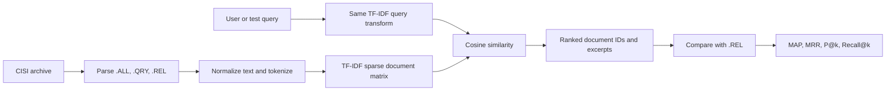

# CISI Information Retrieval System

## Objective

This project implements a reproducible, basic information-retrieval system using the
public CISI collection. Given a query, it ranks research documents by lexical similarity and
measures retrieval quality against the collection's relevance judgments. The design is kept
small enough to inspect and explain, while using the same classical retrieval foundations as
the larger PGS search engine in this repository.

## Dataset

CISI is the Information Retrieval test collection hosted by the University of Glasgow. The
official archive contains `CISI.ALL` (documents), `CISI.QRY` (queries), and `CISI.REL`
(query-document relevance judgments). On first run, the program downloads the archive from
[the official CISI collection page](https://ir.dcs.gla.ac.uk/resources/test_collections/cisi/)
and caches only those three files in `~/.cache/pgs-cisi-ir`. The dataset is not committed to
this repository.

The run used for this report parsed 1,460 documents and 112 queries. The relevance file
contains judgments for 76 of those queries; only those judged queries are included in the
reported evaluation metrics.

## System Design



The implementation is in [`cisi_ir.py`](cisi_ir.py).

1. **Parsing:** records begin with `.I`; `.T`, `.A`, and `.W` provide title, abstract, and
   document/query text. The parser combines those fields and ignores author and other metadata.
   Relevance rows are parsed into a mapping from query ID to relevant document IDs.
2. **Preprocessing:** scikit-learn lowercases text, strips accents, removes English stop words,
   and creates unigram and bigram features. Sublinear term frequency reduces the impact of
   repeated words. These deterministic settings are shared by document and query vectors.
3. **Indexing:** `TfidfVectorizer` builds a sparse TF-IDF matrix, one row per document. This is
   the searchable in-memory index; no separate search server is needed.
4. **Retrieval model:** each query is transformed into the same feature space. Cosine similarity
   scores the query against document rows; results are sorted by descending score. TF-IDF with
   cosine similarity was selected for this introductory baseline because it is transparent,
   reproducible, and has no additional model-training step. The production PGS engine separately
   uses OpenSearch BM25 and hybrid retrieval; this coursework demo does not depend on that stack.
5. **Evaluation:** the relevance file provides ground truth. The program reports mean average
   precision (MAP), mean reciprocal rank (MRR), precision at the requested cutoff, and recall at
   that cutoff across queries with judgments.

## Reproduction

From the repository root, with the `search-engine` dependencies installed:

```powershell
python search-engine/coursework/cisi_ir.py --top-k 5 --query-id 1
python -m pytest search-engine/coursework/test_cisi_ir.py -q
```

For this standalone demo, the only runtime packages needed are NumPy and scikit-learn:

```powershell
python -m pip install numpy scikit-learn
```

The first command downloads CISI if it is not already cached. Use `--data-dir PATH` to select a
different cache location, `--query-id N` to show a different query, and `--top-k N` to change the
number of displayed results and the P@N/Recall@N cutoff.

## Results

The following snapshot is from `--top-k 5 --query-id 1`:

```text
Indexed 1460 documents; vocabulary=90761 features; queries=112.

Evaluation (all queries with relevance judgments):
MAP: 0.1949
MRR: 0.5820
P@5: 0.3500
Recall@5: 0.0836
evaluated_queries: 76

Query: What problems and concerns are there in making up descriptive titles?
Rank  Score   Document ID  Title
1     0.0844  1281         Relative Effectiveness of Document Titles and Abstracts...
2     0.0835   722         Information Transfer Limitations of Titles...
3     0.0723  1299         Current Physics Information
4     0.0683   447         A Note on the Concept of "Relevance"
5     0.0659   429         The Information Content of Titles in Engineering Literature
```

Scores and abbreviated titles are included to make the ranking inspectable. The reported
Recall@5 is lower than P@5 because judged queries may have many relevant documents outside the
top five. MRR 0.5820 indicates that the first relevant result is often near the top. MAP 0.1949
shows room to improve ordering throughout the ranked lists.

## Limitations and Next Steps

This is a lexical baseline, so it cannot reliably match synonyms or understand semantic intent.
The historical CISI corpus is small, English-only, and has relevance judgments for only part of
its query set. The current evaluation uses one fixed vectorizer configuration and does not tune
parameters on a held-out split. A fair next experiment would compare this baseline against BM25
on the same collection and judgments, then report both systems with identical metrics. Semantic
embeddings, stemming, and a user interface are intentionally left out of this basic version.

## Repository Context

The wider PGS repository is a Nepal-focused bilingual search product with a crawler, ETL,
OpenSearch BM25 retrieval, vector-search components, geographic filtering, and a gRPC service.
This coursework implementation is isolated in `search-engine/coursework/` so its dataset,
evaluation, and command line can be understood and run without bringing up the full stack.